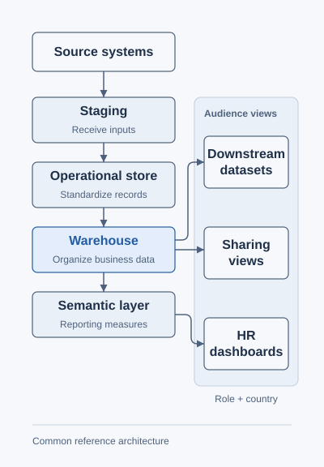

# Workforce data platform

> **Confidentiality disclaimer:** This is a generic portfolio reference using fictional examples. It contains no employer code, internal identifiers, confidential schemas, real employee data, or confidential implementation details, and does not reproduce or expose the employer's implementation.

At Thales, I implement data pipelines and reporting for critical HR data covering the company's global workforce — tens of thousands of employees worldwide. I bring information from different sources into a consistent structure and make the right view available to each audience.

The diagrams illustrate common reference patterns and fictional scenarios.

## How the data becomes useful

<picture>
  <source media="(prefers-color-scheme: dark)" srcset="assets/data-platform-dark.svg">
  
</picture>

The layers turn different inputs into consistent business information. The outputs serve different needs: HR reporting, approved exchanges with other organizations, and preparation for authorized analytics or model-training consumers. Role and country rules limit each audience's access; having one platform does not give everyone the same view.

## My contribution

I handle implementation across ingestion, transformation, data modeling, and delivery. I work with the product owner on requirements, discuss architecture with the technical lead, and coordinate execution with other engineers and interns.

For an HR team, this means usable reporting and controlled sharing without relying on each team to reconcile source systems independently.

## Technical detail

- [Architecture and delivery boundaries](docs/architecture.md): each layer's purpose and where access restrictions apply.
- [Implementation responsibilities](docs/delivery.md): translating requirements into pipelines, reporting structures, and recipient views.
- [Synthetic-data reference design](https://github.com/MahdiHajjHassan/policy-aware-data-generator): a separate public example of recipient-specific development data.

[Mahdi Hajj Hassan](https://github.com/MahdiHajjHassan)
