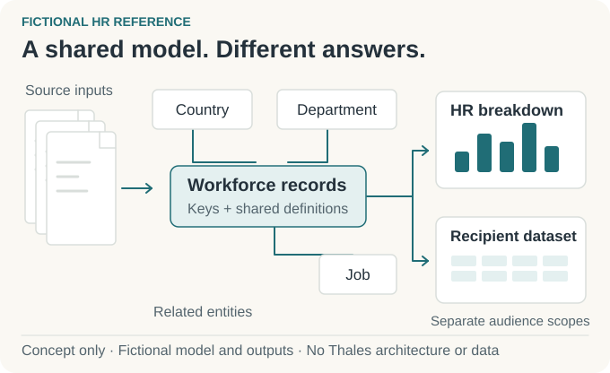

# HR DataFlow

## HR reporting and recipient delivery pipelines — different questions, dependable answers.

> [!CAUTION]
> **Independent portfolio demo — no Thales implementation or data.**
> This showcase uses fictional data and generic reference designs to explain engineering ideas from my professional experience. It does not reproduce, document, or disclose Thales's actual systems, architecture, configuration, or critical data. It is not an official Thales project or endorsement.

An HR team needs to understand its workforce. Another team needs a smaller set of information to do its own job. Both depend on the same underlying facts, but the answer each receives has to fit its question and its permitted scope.

**My work is the engineering between those inputs and useful answers.** At Thales, I implement pipelines and reporting for critical HR data covering tens of thousands of employees worldwide. This public showcase explains the ideas through a fictional reference that readers can explore.

It is for **HR teams and authorized downstream recipients**: people who need consistent reporting, clearly defined information, and an output appropriate to their responsibilities.

<picture>
  <source media="(prefers-color-scheme: dark) and (max-width: 540px)" srcset="assets/workforce-story-v2-mobile-dark.svg">
  <source media="(max-width: 540px)" srcset="assets/workforce-story-v2-mobile-light.svg">
  <source media="(prefers-color-scheme: dark)" srcset="assets/workforce-story-v2-dark.svg">
  
</picture>

*Concept illustration of the fictional reference; not an application screenshot or an employer system diagram.*

### One workforce, two different requests

Imagine a fictional organization with teams in several countries. Its HR analyst is preparing a workforce breakdown for the countries they are allowed to report on. An authorized operations team needs a narrower dataset for its own planning.

The analyst asks, **“How many people are in each employment category across my permitted countries?”** The operations team asks, **“Which approved operational attributes do we need for our task?”**

Those requests share business information. They do not share an identical delivery contract.

| Fictional audience | What they need | What shapes the answer |
| --- | --- | --- |
| HR analyst | A workforce breakdown with understandable categories and measures. | The reporting definition and the analyst's permitted role and countries. |
| Authorized operations recipient | A smaller set of operational attributes. | The recipient's approved purpose, fields, and records. |

For the analyst, a count is useful only if its population and categories mean what the report says they mean. For the operations team, receiving a dataset is useful only if its scope matches the job it was approved for.

That is why I care about the work behind the dashboard: agreeing on the question, making the information consistent, and carrying the audience boundary through to delivery.

### Where I contribute

I work across **ingestion, transformation, data modeling, and delivery**. I turn approved requirements and architecture into pipelines, reporting structures, and controlled outputs.

- **With the product owner,** I make the reporting or sharing outcome concrete: the population, measures, and intended recipient.
- **With the technical lead,** I discuss the architecture and implementation boundaries that shape the work.
- **With engineers and interns,** I coordinate execution and connect individual changes to the delivery requirement.

This is implementation work in a team. The fictional reference below gives me a way to explain the engineering without exposing employer systems or records.

---

<strong>Engineering details: from source inputs to audience-specific outputs</strong>

### Give each layer a clear job

The public reference separates receiving information, reconciling it, modeling it for analysis, and exposing reporting definitions. Each step answers a different engineering question.

| Layer | Job in the fictional reference | Decision to make |
| --- | --- | --- |
| Staging | Receive source inputs. | What arrived, how is it structured, and where does input validation belong? |
| Operational data store | Standardize records and relationships. | Which types, keys, and transformation rules make different sources consistent? |
| Data warehouse | Organize information for analytics. | What business definitions and models answer the reporting question, including history where required? |
| Semantic / cube layer | Expose measures and reporting structures. | Which calculations and dimensions make the dashboard's meaning consistent? |

The separation gives each concern a place, but a source change can affect several layers. Implementation review therefore needs to follow the change through to the business output.

*Fictional reference architecture; not an employer system diagram.*

<picture>
  <source media="(prefers-color-scheme: dark)" srcset="https://raw.githubusercontent.com/MahdiHajjHassan/workforce-data-platform/main/assets/data-platform-dark.svg">
  
</picture>

### Model the question before delivering the answer

In the fictional workforce request, “a breakdown” needs an agreed population, categories, and measures before it becomes a reporting requirement. Bringing inputs into one structure does not settle those definitions by itself.

I translate that requirement into transformations, models, and outputs. The public delivery notes identify checking audience visibility as part of the implementation responsibility; they do not provide employer checks or runtime results.

### Share business meaning; define each output separately

A dashboard, a sharing view, and an authorized downstream dataset have different consumers. Reusing consistent business information is useful, but the reporting model alone does not define a recipient's contract.

For the fictional operations request, I would clarify **which records** the recipient may receive and **which attributes** those records may expose. A need for workforce counts does not establish a need for every employee attribute.

The reference considers role and country together. This makes delivery boundaries more explicit, while requiring a recipient change to be reviewed for both business meaning and permitted scope.

### What to inspect next

- [Architecture and delivery boundaries](https://github.com/MahdiHajjHassan/workforce-data-platform/blob/main/docs/architecture.md): layer responsibilities, output types, and audience scope.
- [Implementation responsibilities](https://github.com/MahdiHajjHassan/workforce-data-platform/blob/main/docs/delivery.md): my role and the fictional requirement behind this story.
- [Policy-aware synthetic-data reference](https://github.com/MahdiHajjHassan/policy-aware-data-generator): a separate documentation-only example of recipient-specific development data and static fictional fixtures.

*Public material: professional responsibilities explained through fictional examples and generic patterns. The repository provides documentation, not an executable employer replica or evidence of measured business outcomes.*

[Back to my portfolio](https://github.com/MahdiHajjHassan)
