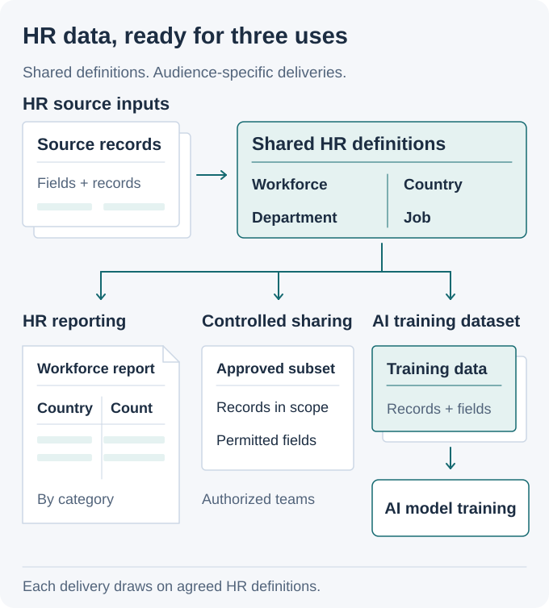
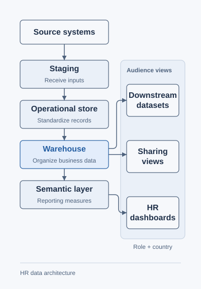

# HR Data Platform

> [!CAUTION]
> **Confidential enterprise work.** I worked with critical HR information at Thales. This public explanation uses independent examples, with no Thales implementation or data and no employer endorsement. Diagrams explain the architecture without disclosing employer systems or records.

## HR reporting, controlled sharing, and datasets for AI training

HR analysts need consistent workforce reports. Other business teams need approved subsets of the data. AI teams need datasets for model training. I delivered the pipelines and data structures that connected these needs to usable HR information at Thales.

**My contribution:** ingestion, SQL transformations, data modeling, reporting, and dataset delivery for critical HR information covering tens of thousands of employees worldwide. I clarified requirements with the product owner, discussed architecture with the technical lead, and coordinated delivery with engineers and interns.

**Tools:** SQL Server · T-SQL · Talend ETL · Power BI · DAX · SSAS

<picture>
  <source media="(prefers-color-scheme: dark) and (max-width: 540px)" srcset="assets/workforce-story-v5-mobile-dark.svg">
  <source media="(max-width: 540px)" srcset="assets/workforce-story-v5-mobile-light.svg">
  <source media="(prefers-color-scheme: dark)" srcset="assets/workforce-story-v5-dark.svg">
  
</picture>

### One source of HR information, three uses

| Audience | What they need | Why it matters |
| --- | --- | --- |
| HR analysts | Workforce breakdowns with agreed populations, categories, and measures. | A report needs a consistent definition of who and what it counts. |
| Authorized business teams | Selected records and fields for their responsibilities. | A team receives the information relevant to its task and permitted scope. |
| AI teams | HR datasets supplied for model training. | Training-data preparation connects enterprise information to AI work. |

For example, an HR analyst may need headcount by country and employment category, while an operations recipient needs department and assignment information. These outputs share business definitions but have different fields and audiences.

### What I delivered

- Turned business requirements into ingestion and transformation work.
- Connected operational records to analytical models and reporting definitions.
- Delivered reporting and controlled datasets, including inputs for AI model training.
- Validated changes and supported deployment and production troubleshooting.

<strong>Engineering details: data layers, reporting, and access rules</strong>

### From incoming records to reporting

| Layer | Job |
| --- | --- |
| Staging | Receive source inputs and check their structure. |
| Operational data store (ODS) | Standardize types, keys, and relationships across sources. |
| Data warehouse | Organize business facts and dimensions for analysis, including history where required. |
| Semantic / cube layer | Define shared measures and dimensions for reports. |

<picture>
  <source media="(prefers-color-scheme: dark)" srcset="assets/data-platform-v2-dark.svg">
  
</picture>

### Define the output as well as the model

The reporting population, categories, and calculations define what a dashboard means. A dataset also needs its own permitted records and fields. A team that needs workforce counts does not automatically need salary or identity fields.

For AI training datasets, the approved purpose and access rules shape the delivered data. Preparing the dataset is part of the data engineering work that supports model training.

### Read further

- [Architecture and access rules](https://github.com/MahdiHajjHassan/workforce-data-platform/blob/main/docs/architecture.md)
- [My delivery responsibilities](https://github.com/MahdiHajjHassan/workforce-data-platform/blob/main/docs/delivery.md)
- [Permission-aware development datasets](https://github.com/MahdiHajjHassan/policy-aware-data-generator)

[Back to my portfolio](https://github.com/MahdiHajjHassan)
